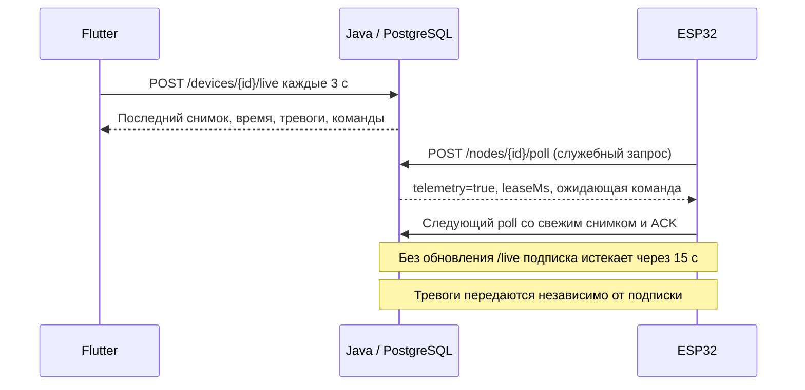

# Java-облако

Java 21, Spring Boot 3.5, PostgreSQL 17. Бэкенд не открывает COM-порты и не использует Telegram.

## Почему один Flutter-клиент

Приложение уже умеет работать по BLE с обеими платами. В него добавлены аккаунт и удалённый экран; локальная настройка остаётся доступна без облака. REST API можно использовать и для будущего веб-клиента. Сейчас веб-интерфейс и фоновый APNs/FCM push не реализованы.

## Развёртывание

На Linux-сервере нужны Docker Compose, домен с DNS-записью на сервер и входящие TCP 80/443. У ESP32 должен быть исходящий интернет, включая DNS и SNTP (UDP 123). Сертификат обязан доверяться стандартному CA bundle ESP-IDF: проверка TLS не отключается.

Из каталога backend:

```sh
cp .env.example .env
# Отредактируй CLOUD_DOMAIN и DB_PASSWORD.
# Для первоначальной регистрации поставь REGISTRATION_ENABLED=true.
docker compose up -d --build
docker compose logs -f backend
```

Caddy получает публичный сертификат автоматически. PostgreSQL и порт Java не публикуются наружу. Проверка: GET https://ваш-домен/api/health. После создания аккаунта поставь REGISTRATION_ENABLED=false и выполни `docker compose up -d backend`.

База и сертификаты находятся в именованных Docker volumes. Остановка/перезапуск контейнеров их не удаляет. `docker compose down -v` уничтожит эти данные, поэтому для обычного перезапуска эту команду не используй. Для старой Telegram-базы автоматической миграции нет: создай отдельную пустую базу для новой системы.

Без Docker: создай PostgreSQL-базу, задай DB_URL/DB_USER/DB_PASSWORD и выполни `mvn clean verify`, затем `java -jar target/app-0.1.0.jar`. Адрес прослушивания SERVER_ADDRESS и порт SERVER_PORT читаются из application.yml / окружения; defaults 0.0.0.0:8080. Можно передать собственный файл: `--spring.config.additional-location=file:./cloud.yml`. Публичный доступ всё равно должен идти через HTTPS-прокси.

## Подключение с телефона

1. Обнови обе прошивки по firmware/README.md и Flutter-приложение.
2. Открой «Облако» в приложении. Введи https://ваш-домен (порт можно указать явно), зарегистрируйся/войди. Адрес по умолчанию можно задать в mobile/assets/cloud.json до сборки. Секретов в этом файле быть не должно.
3. Вернись на BLE-экран, подключись к конкретной ESP32 и открой «Настроить Wi-Fi».
4. Введи SSID и пароль, включи привязку к облаку и добавь устройство с понятным именем. Сервер создаст UUID и отдельный случайный ключ устройства; приложение передаст их по защищённому BLE.
5. Дождись статуса «Облако на связи», отключи BLE и открой устройство на облачном экране. Повтори для другой платы.

Для повторной настройки выбирай существующее устройство в аккаунте: будет заменён его ключ, история сохранится. Если передача BLE не удалась, повторная попытка в том же открытом экране использует выданный ключ. Если экран уже закрыт — выбери созданную запись и перевыпусти ключ. При этом прежний ключ немедленно перестаёт работать.

Изменение только Wi-Fi не требует входа в облако и сохраняет текущую привязку. BLE остаётся способом локального управления при отказе интернета.

## Протокол



Все пользовательские и аппаратные маршруты требуют Authorization: Bearer с отдельным токеном. Устройства не могут использовать пользовательские токены, пользователи — аппаратные. UUID устройства не является секретом или способом авторизации. Доступ к чужому устройству возвращает 404.

| Маршрут | Назначение |
| --- | --- |
| POST /api/auth/register, /api/auth/login | email/password → пользовательский token |
| POST /api/auth/logout | Отзыв текущей сессии |
| GET /api/devices | Свои устройства |
| POST /api/devices | name, role SECURITY/CLIMATE → id/token |
| POST /api/devices/{id}/token | Замена аппаратного ключа своего устройства |
| POST /api/devices/{id}/live | Обновить подписку на 15 с, получить снимок |
| GET /api/devices/{id} | Снимок/история без продления подписки |
| POST /api/devices/{id}/commands | code 1–4, команда с TTL 30 с |
| POST /api/nodes/{id}/poll | Аппаратный heartbeat, ACK, тревоги, опционально снимок |

Снимок packet — 18 байт существующего BLE-протокола в виде 36 hex-символов. sampled_at — время приёма облаком, не время физического измерения. Старый снимок всегда сопровождается временем и может оставаться видимым при потере связи. Роль сверяется с зарегистрированной.

Poll содержит alerts (до 8 записей), lostAlerts, ackId/ackStatus и packet только при активной подписке. Событие: id (32 hex), kind DISTANCE/LIGHT/OVERHEAT, uptimeMs, occurredAt (Unix ms, необязательно). Ответ: telemetry, leaseMs, ackEvents, command (id/code/ttlMs либо null). Сервер подтверждает события только после транзакционного сохранения; повтор одного event ID не создаёт дубликат. Разные устройства имеют отдельные пространства ID.

Запросы ESP32 выполняются примерно раз в 3 секунды; при ошибках задержка увеличивается до 30 секунд. Служебный трафик присутствует всегда, даже без зрителя. Когда экран закрыт/приложение свёрнуто, Flutter прекращает продлевать подписку. Для нескольких зрителей достаточно последнего обновления; один клиент не отменяет подписку другого.

Команды абсолютные: 1 disarm, 2 arm, 3 siren off, 4 siren on. До ACK команда может быть повторена. После перезагрузки платы возможное повторное применение той же абсолютной команды допустимо; exactly-once не заявляется. Ожидание ограничено 30 секундами; поздний ACK не превращает истёкшую команду в новую. Время round-trip вычитается из TTL на плате. APPLIED означает приём настройки прошивкой, а не подтверждение физического исполнительного механизма.

## Восстановление и границы

- ESP32 хранит до 64 тревог во flash. При восстановлении связи повторяет доставку, PostgreSQL устраняет дубликаты. Переполнение отбрасывает новые события и увеличивает видимый счётчик потерь. Это ограниченный буфер, а не бесконечный журнал.
- PostgreSQL хранит пользователей, сессии, ключи в виде SHA-256, команды и историю тревог. Пароли аккаунтов хешируются BCrypt; API ограничивает запросы входа и размер POST. Регистрация по умолчанию закрыта.
- Сессия действует 24 часа (SESSION_HOURS). Телефон держит токен только в памяти, поэтому после перезапуска приложения нужен вход. Пароль и аппаратный ключ на телефоне постоянно не сохраняются.
- Без синхронизации SNTP у события нет календарной метки, но сохраняются uptime и ID. Сервер отдельно отмечает время получения. RTC DS3231 — следующий этап.
- Отказ облака не останавливает локальную охрану/BLE. После отключения питания сохраняются очередь и сетевые настройки; состояние охраны/сирены пока загружается из существующих начальных значений прошивки.
- Нет полной истории обычных замеров, репликации базы, ESP32→ESP32, резервного Ubuntu-хранилища, RabbitMQ, OTA, push при закрытом приложении. Брокер сам по себе не восстановил бы данные, потерянные до отправки: сначала нужен этот локальный outbox.
- HTTPS проверяется стандартным bundle. Wi-Fi и ключ устройства в NVS пока не защищены от физического чтения flash. Для эксплуатации за пределами стенда нужны отдельные настройки аппаратной защиты, резервного копирования базы и мониторинга.

## Проверка на стенде

1. Открой устройство в облаке: после 1–2 циклов опроса появятся показания. Закрой экран; через 15 секунд новые снимки перестанут сохраняться, last_seen продолжит обновляться.
2. Проверь с телефона через мобильный интернет, что управление не зависит от BLE и локальной Wi-Fi-сети телефона. Дождись APPLIED и изменения показания состояния.
3. Останови backend, вызови несколько тревог и проверь длину очереди через BLE. Запусти backend — тревоги должны появиться в истории один раз, очередь очиститься.
4. Повтори с выключением/включением питания платы после фиксации тревоги в очереди. Пока SNTP не синхронизирован, история должна явно показывать неизвестное время события.
5. Отправь команду и оборви связь до доставки. Восстанови спустя более 30 секунд: просроченная команда не должна выполняться.
6. Проверь BLE-управление и смену Wi-Fi при остановленном backend.

Автотесты `mvn clean verify` используют H2 в PostgreSQL-режиме и проверяют авторизацию, TTL, demand telemetry, дедупликацию и ограничения климатической платы. Это не заменяет проверку PostgreSQL/Caddy на сервере и отключений питания на физических ESP32.

Технические источники: [Spring Boot 3.5](https://docs.spring.io/spring-boot/3.5/system-requirements.html), [ESP-IDF HTTPS client и CA bundle](https://docs.espressif.com/projects/esp-idf/en/v5.5.6/esp32/api-reference/protocols/esp_http_client.html).
